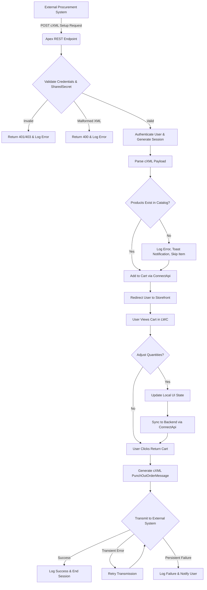

# Salesforce B2B Commerce cXML PunchOut Integration

**ID**: SPEC-PUNCHOUT-001
**Version**: 1.0
**Status**: Draft
**Type**: Functional Specification

## Overview & Purpose
The organization operates in the B2B sector using Salesforce B2B Commerce as its storefront. To reduce friction for B2B customers, the organization needs to integrate directly with external procurement systems using standard cXML PunchOut workflows. Currently, disconnected purchasing flows require manual logins and manual cart transfers, which disrupts the procurement process. 

This initiative implements a seamless PunchOut session. It allows external procurement systems to send a cXML request that automatically authenticates the user, pre-populates their cart in Salesforce B2B Commerce, allows them to adjust quantities, and returns the finalized cart data to their originating system without requiring manual authentication at any step.

## Goals
- **OBJ-01**: Enable seamless authentication for external procurement users via cXML PunchOut. (Measure: 100% of valid cXML PunchOut Setup Requests result in an authenticated session without manual login prompts).
- **OBJ-02**: Automate cart population and return workflows between systems. (Measure: 100% of successfully reviewed carts are transmitted back to the originating procurement system via a valid cXML PunchOutOrderMessage).

## Target Users
- **Procurement Customer**: External B2B users accessing the storefront via their own procurement systems.
- **B2B Commerce Administrator**: Internal users responsible for system configuration, monitoring, and troubleshooting.

## Stakeholders
- **Procurement Customer**
  - *Decision authority*: None
  - *Concerns*: Seamless access to the storefront without separate credentials; accurate transfer of pre-selected products into the cart; ability to easily return the finalized cart to their own procurement system.
- **B2B Commerce Administrator**
  - *Decision authority*: System configuration and monitoring
  - *Concerns*: Observability of integration failures; security of the storefront and API endpoints.

## Scope

**In Scope**:
- Apex REST endpoint to receive and process incoming cXML PunchOut Setup Requests.
- Automated, seamless authentication via cXML MAC/Shared Secret validation.
- Parsing of cXML payloads (using `Dom.Document`) and automatic cart population via Salesforce B2B Commerce `ConnectApi`.
- Lightning Web Component (LWC) for users to review and adjust cart quantities.
- Generation and transmission of cXML `PunchOutOrderMessage` containing finalized cart contents back to the external system.
- Custom Integration Log object to record all inbound and outbound cXML payloads.

**Out of Scope**:
- Manual user registration or login flows for PunchOut users.
- Manual login screens or password reset flows.
- Checkout, tax calculation, and payment processing within Salesforce B2B Commerce (handled by the external procurement system).
- Order creation within Salesforce B2B Commerce.

## MoSCoW
None specified.

## Functional Requirements

- **FR-01**: The system shall expose an Apex REST endpoint to receive incoming cXML PunchOut Setup Requests.
  - *Acceptance Criteria*: GIVEN a valid cXML Setup Request is sent by an external system WHEN the Apex REST endpoint receives it THEN the system processes the request and returns a redirect URL to the storefront.
- **FR-02**: The system shall validate the Sender credentials and SharedSecret in the cXML header before initiating a Salesforce session.
  - *Acceptance Criteria*: GIVEN an incoming cXML Setup Request WHEN the system processes the header THEN it validates the SharedSecret and Sender credentials, rejecting invalid requests with a 401 or 403 HTTP status.
- **FR-03**: The system shall parse the incoming cXML payload using `Dom.Document` and use the `ConnectApi` namespace to add items to the B2B Commerce cart.
  - *Acceptance Criteria*: GIVEN a validated cXML payload containing product IDs WHEN the storefront session initializes THEN the system parses the document and successfully adds the recognized products to the user's cart via `ConnectApi`.
- **FR-04**: The system shall provide a Lightning Web Component (LWC) for users to review and adjust cart quantities, managing state locally before explicitly syncing to the backend.
  - *Acceptance Criteria*: GIVEN a populated cart in the LWC WHEN the user adjusts quantities THEN the UI updates locally, and WHEN the user clicks update/checkout THEN the changes sync to the backend via `ConnectApi`.
- **FR-05**: The system shall generate and transmit a cXML `PunchOutOrderMessage` containing the finalized cart contents back to the originating procurement system.
  - *Acceptance Criteria*: GIVEN a finalized cart WHEN the user chooses to return the cart THEN the system generates a valid cXML `PunchOutOrderMessage` and transmits it to the external system's return URL.
- **FR-06**: The system shall log all inbound and outbound cXML payloads, including Event Type, Timestamp, Request Id, User Id, Payload, and Status, to a custom Integration Log object.
  - *Acceptance Criteria*: GIVEN any inbound cXML request or outbound cXML message WHEN the transaction completes or fails THEN the system writes a record to the Integration Log custom object containing all specified fields.

## User Stories

- **US-01**: As a Procurement Customer, I want to automatically authenticate into the storefront via a cXML PunchOut request, so that I do not have to manage separate login credentials or manually log in.
- **US-02**: As a Procurement Customer, I want to have my pre-selected products automatically populate my cart, so that I can immediately review my intended purchase upon entering the storefront.
- **US-03**: As a Procurement Customer, I want to review and adjust product quantities in my cart, so that I can finalize my order details before returning to my procurement system.
- **US-04**: As a Procurement Customer, I want to return my finalized cart to my procurement system, so that I can complete the requisition process internally.

## Inputs/Outputs/Data Flow

**Inputs**:
- **cXML PunchOut Setup Request**: Inbound HTTP POST containing Sender credentials, SharedSecret, user identification, and pre-selected product IDs/quantities.
- **User UI Actions**: Quantity adjustments and checkout/return triggers within the LWC.

**Outputs**:
- **HTTP Redirect (302)**: Outbound response to the Setup Request directing the user's browser to the authenticated storefront session.
- **HTTP Error Responses (400, 401, 403)**: Outbound responses for malformed payloads or invalid credentials.
- **cXML PunchOutOrderMessage**: Outbound HTTP POST to the external procurement system containing the finalized cart data (Product IDs, final quantities, standard B2B pricing).
- **Integration Log Records**: Database inserts capturing payload and metadata for observability.

## Flows

## Edge Cases & Error States

- **EC-01: Missing or invalid SharedSecret in cXML Setup Request**
  - *Handling*: The system must return a 401 or 403 HTTP status to the external system, log the failed attempt in the Integration Log, and deny access.
- **EC-02: Malformed cXML payload**
  - *Handling*: The system must return a 400 HTTP status with a cXML `<Status code="400">` response and log the validation error.
- **EC-03: Product in cXML payload does not exist in Salesforce**
  - *Handling*: The system must log a business error, notify the user via a toast event in the LWC, and continue processing the remaining valid products without crashing the cart.
- **EC-04: External procurement system unreachable during cart return**
  - *Handling*: The system must retry transient errors. If it ultimately fails, it must log the failure in the Integration Log and notify the user.

## Acceptance Criteria (Given/When/Then)

**Authentication & Access (US-01, FR-01, FR-02)**
- **GIVEN** a valid cXML Setup Request with correct Sender credentials and SharedSecret is received by the Apex REST endpoint **WHEN** the system processes the request **THEN** the system authenticates the user and automatically redirects them to the storefront.
- **GIVEN** a cXML Setup Request with an invalid SharedSecret or Sender credentials is received **WHEN** the system processes the request **THEN** the system returns a 401 or 403 HTTP status to the external system and logs the failed attempt.

**Cart Population (US-02, FR-03)**
- **GIVEN** an authenticated PunchOut session initiated with a cXML payload containing valid product IDs **WHEN** the storefront loads **THEN** the cart is automatically populated with the requested products using `ConnectApi`, applying standard B2B pricing.
- **GIVEN** the incoming cXML payload contains a product ID that does not exist in the Salesforce catalog **WHEN** the system attempts to add the items to the cart **THEN** the system logs a business error, notifies the user in the LWC UI, and successfully processes the remaining valid products without crashing the cart.

**Cart Adjustment (US-03, FR-04)**
- **GIVEN** a populated cart displayed in the Lightning Web Component **WHEN** I increase or decrease the quantity of a product **THEN** the cart state updates locally in the UI.
- **GIVEN** local quantity adjustments have been made in the Lightning Web Component **WHEN** I explicitly click the update or checkout action **THEN** the system syncs the updated quantities to the Salesforce backend using `ConnectApi`.

**Cart Return (US-04, FR-05)**
- **GIVEN** a finalized cart in Salesforce B2B Commerce **WHEN** I choose to return the cart to my procurement system **THEN** the system generates a cXML `PunchOutOrderMessage` and transmits it to the external system.
- **GIVEN** the system is attempting to transmit the `PunchOutOrderMessage` **WHEN** the external system fails to respond or returns a transient error **THEN** the system retries the transmission and logs a failure if it remains unsuccessful.

**Observability (FR-06)**
- **GIVEN** an inbound or outbound cXML payload is processed **WHEN** the transaction concludes **THEN** the system logs the Event Type, Timestamp, Request Id, User Id, Payload, and Status to the Integration Log custom object.

## Non-Functional Requirements

- **NFR-01 (Security)**: The system must bypass manual login entirely for PunchOut sessions, relying strictly on server-side cXML MAC/Shared Secret validation. (Target: 0 manual login prompts presented to PunchOut users).
- **NFR-02 (Observability)**: The system must record all integration traffic for debugging and auditing purposes. (Target: 100% of inbound and outbound cXML payloads are saved to the Integration Log custom object).
- **NFR-03 (Performance)**: The system must process incoming cXML Setup Requests and redirect the user promptly. (Target: < 3 seconds from receiving the cXML request to returning the redirect URL).

## Assumptions
- **AD-02**: The storefront must accept and parse pre-populated cart payloads from the initial cXML request, focusing the UI solely on cart review and quantity adjustment. (Impact if wrong: The UI and backend logic would need to be redesigned to support browsing and adding products manually within the storefront during a PunchOut session).
- **Business Rule Assumption**: All cart modifications must utilize the standard B2B Commerce `ConnectApi` to guarantee that standard B2B pricing, entitlement rules, and platform integrity are maintained.

## Dependencies
- **AD-01**: External procurement systems are capable of sending and receiving standard cXML PunchOut Setup and Order messages. (Impact if wrong: The integration will fail to communicate with the external systems, requiring custom middleware or protocol translation).

## Open Questions
- **OQ-01**: What specific cXML version and DTDs are supported by the target external procurement systems? *(Recommended default: Assume standard cXML version 1.2.014 compatibility).*
- **OQ-02**: How should the system handle cart pricing if the external system sends a unit price in the cXML payload that differs from the Salesforce B2B Commerce pricebook? *(Recommended default: Override the external price and use the Salesforce B2B Commerce ConnectApi pricing as the strict source of truth).*
- **OQ-03**: What is the MoSCoW prioritization for the listed requirements, as none was specified in the initial documentation?

## Success Metrics
- **SM-01 (Leading) — Successful PunchOut Sessions**: 100% of valid cXML Setup Requests result in a successfully authenticated session. (Data required: Integration Log records and Salesforce Login History).
- **SM-02 (Lagging) — Cart Return Success Rate**: 99% of finalized carts are successfully transmitted back to the procurement system. (Data required: Integration Log records tracking outbound `PunchOutOrderMessages`).